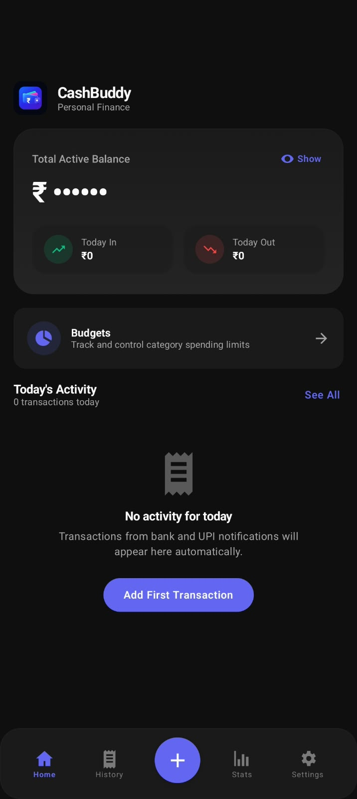
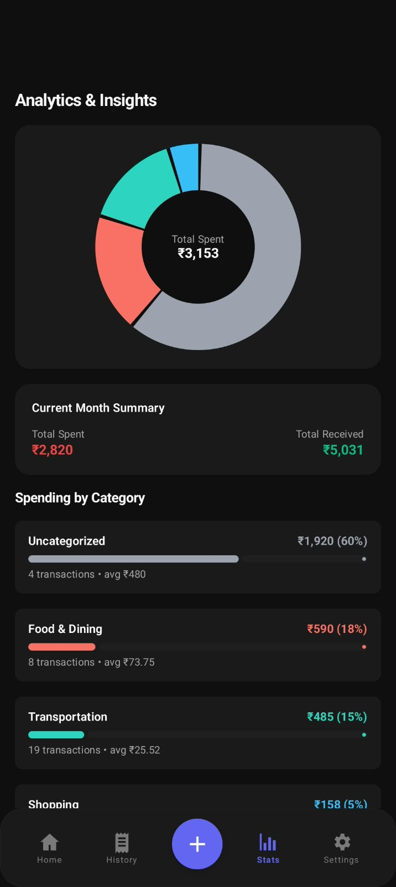
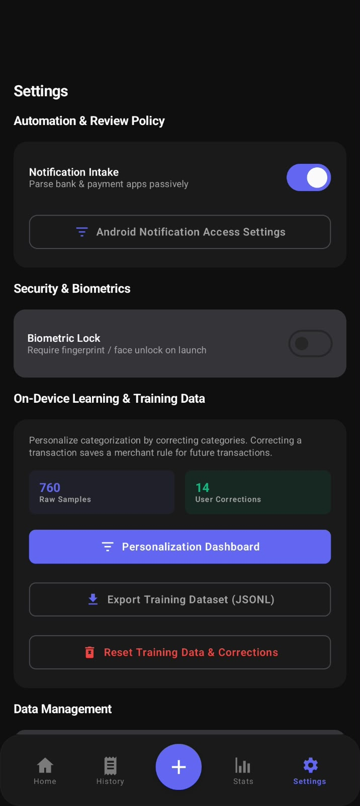

<div align="center">


# CashBuddy 💸

> **The 100% Offline, Privacy-First Finance Tracker for India.**

[](https://kotlinlang.org/docs/multiplatform.html)
[](https://www.jetbrains.com/lp/compose-multiplatform/)
[](#-the-pitch-why-cashbuddy)
[](LICENSE)
[](#-building-the-app)
[](#️-tech-stack)

</div>

---

## 💡 The Pitch (Why CashBuddy?)

### The Problem
Most personal finance management (PFM) apps in India ask for intrusive permissions: full read access to your entire SMS inbox, mandatory cloud signups, and constant internet connectivity. Behind the scenes, detailed transaction trails, merchant visits, and sensitive bank account details are uploaded to centralized servers for targeted advertising, credit profiling, or data brokerage.

### The CashBuddy Solution
**CashBuddy solves this by proving that smart financial tracking does not require a single byte of cloud telemetry.**

- **Zero Network Permission (`android.permission.INTERNET` is completely absent):** CashBuddy strips the internet permission entirely from its Android manifest. It cannot send packets even if it tried.
- **Zero SMS Permission:** Rather than demanding broad SMS inbox access, it exclusively leverages `BIND_NOTIFICATION_LISTENER_SERVICE` and Android share sheets to ingest transaction updates as they happen.
- **Local-Only Intelligence:** Bank transactional alerts, UPI notifications (GPay, PhonePe, Paytm, CRED, BHIM), and shared payment receipts (via on-device OCR) are parsed, classified, and deduplicated directly on your smartphone.
- **100% Private, 100% Yours:** Your data never leaves your device. Period.

---

## 📱 Screenshots

<div align="center">

| 🏠 Home Screen | 📊 Analytics & Insights | 📥 Review Inbox |
|:---:|:---:|:---:|
|  |  |  |
| *Live Balance, Quick Stats, Keyset Paging* | *Interactive Category Pie Chart & Trends* | *Human-in-the-Loop Confidence Review* |

</div>

> *Note: Feature graphic and raw visual assets are cataloged in [`play_store_assets/`](play_store_assets/).*

---

## ✨ Killer Features

### 🔒 Zero-Network Architecture
Every file across the engine and shared multiplatform codebase enforces a strict `// NO-NETWORK` posture. No analytics SDKs, no crash uploaders, no third-party telemetry, and zero HTTP/WebSocket clients. All processing and storage occur entirely within on-device sandboxes.

### ⚡ Smart Ingest, OCR & Keyset Deduplication
- **Multi-Source Intake:** Seamlessly captures expenses from:
  1. Passive notification listeners (50+ Indian banking and UPI apps).
  2. Direct screenshot shares (using Google ML Kit on-device text recognition).
  3. Rapid manual logging with smart merchant and amount suggestions.
- **UTR-Based Keyset Deduplication:** When both an SMS and a UPI notification fire for the same transaction (or when a user shares a screenshot of an already logged notification), CashBuddy's reconciliation engine uses 12-digit UTR (UPI Reference Numbers) and temporal fuzzy matching to merge duplicate records into one clean entry.

### 🧠 On-Device Machine Learning: "Learned Tokens"
Forget bulky 100MB+ LLM downloads. CashBuddy features a lightweight, high-speed on-device **Naive Bayes classifier** with dynamic **Learned Token persistence**:
- Learns local Indian vendor names and regional vernacular (e.g., *"Shanti Sagar"*, *"Bottle Lab"*, *"Amma Mess"*, *"Namma Chai"*) directly from your spending patterns.
- Applies Bayesian probabilistic scoring combined with Laplace smoothing to classify incoming transactions in sub-millisecond execution times.
- Self-optimizes continuously: as you accept or modify transaction categories, the token dictionary refines category probabilities right inside your local database.

### 🛡️ Human-in-the-Loop Review
To guarantee absolute accounting accuracy:
- Any transaction with confidence below **85%** or exceeding **₹10,000** is routed to the **Review Inbox** in `PENDING` status.
- Single-tap category reassignment, payment method switching (`UPI`, `Card`, `Cash`), and loan tracking (`"This is a loan I expect back"`).
- User edits immediately update category models and prevent false auto-confirmations.

### 💳 Real-World Math Engine
- Distinguishes between actual out-of-pocket cash/UPI expenses, credit card liabilities, and loans given to friends.
- Keeps analytics accurate: a ₹50,000 laptop on card EMI or a ₹2,000 dinner split lent to a colleague won't deceptively inflate your monthly food or shopping burn.

---

## 🛠️ Tech Stack

| Layer | Technologies |
|---|---|
| **Core & Logic** | Kotlin Multiplatform (KMP 2.2.1), Pure Kotlin (`commonMain`) |
| **User Interface** | Compose Multiplatform (1.7.3), Material Design 3, Adaptive Edge-to-Edge |
| **Local Database** | SQLDelight 2.0.2 + SQLCipher (AES-256 GCM) |
| **Key Storage** | Android Keystore System (Hardware TEE / StrongBox backed keys) |
| **Security** | BiometricPrompt (`BIOMETRIC_STRONG`), `FLAG_SECURE` window shielding |
| **On-Device Vision** | Google ML Kit Text Recognition (On-device OCR) |
| **Architecture** | Clean Architecture, MVVM + Unidirectional Data Flow (UDF), Koin 4.0 DI |
| **Math & Algorithms** | Naive Bayes Classifier, Median Absolute Deviation (MAD) Z-Score anomaly detection, Jaro-Winkler string distance |

---

## 🏗️ Architecture Overview

```text
┌─────────────────────────────────────────────────────────────────┐
│                    COMPOSE MULTIPLATFORM UI                     │
│    HomeScreen  •  ReviewScreen  •  StatsScreen  •  AddScreen    │
└───────────────────────────────┬─────────────────────────────────┘
                                │ StateFlow / Intents (UDF)
                                ▼
┌─────────────────────────────────────────────────────────────────┐
│                    VIEWMODELS & REDUCERS                        │
│    ReviewViewModel  •  StatsViewModel  •  AddTransactionVM      │
└───────────────────────────────┬─────────────────────────────────┘
                                │ Domain Contracts
                                ▼
┌─────────────────────────────────────────────────────────────────┐
│                      CORE DOMAIN ENGINES                        │
│   • Probabilistic Message Pipeline (Naive Bayes & Regex)        │
│   • Deduplication & Merge Engine (UTR Matching)                 │
│   • Budget Engine & Threshold Pacer                             │
│   • Fraud & Anomaly Detector (MAD Outlier Rejection)            │
└───────────────────────────────┬─────────────────────────────────┘
                                │
                                ▼
┌─────────────────────────────────────────────────────────────────┐
│                 ENCRYPTED DATA ACCESS LAYER                     │
│        SQLDelight 2.0.2  +  SQLCipher (AES-256 GCM)             │
│        Android Keystore TEE  •  100% Offline Storage            │
└─────────────────────────────────────────────────────────────────┘
```

---

## 🚀 Building the App

### Prerequisites
- **JDK 17** or higher
- **Android Studio Ladybug** (or later) / Android SDK Platform 35
- Android device or emulator running **Android 8.0 (API level 26)** or higher

### Build Debug APK
1. Clone the repository:
   ```bash
   git clone https://github.com/your-username/CashBuddy.git
   cd CashBuddy
   ```

2. Assemble the debug APK:
   ```bash
   # On macOS / Linux
   ./gradlew :androidApp:assemblePlayDebug

   # On Windows (PowerShell)
   .\gradlew :androidApp:assemblePlayDebug
   ```

3. The generated APK will be available at:
   ```text
   androidApp/build/outputs/apk/play/debug/androidApp-play-debug.apk
   ```

### Run Unit Tests
To execute the complete unit test suite across engines, repositories, and math validators:
```bash
./gradlew :shared:testAndroidHostTest
```

---

## ⚖️ License & Privacy

### Open Source
CashBuddy is licensed under the [Apache License, Version 2.0](LICENSE). You are free to inspect, study, fork, and build upon this project.

### Privacy Pledge
> **Your data belongs to you. It never leaves your device.**
> 
> CashBuddy has no backend servers, no analytics beacons, and no marketing integrations. All transactions, tokens, and financial models remain cryptographically secured in SQLCipher on your physical hardware.
