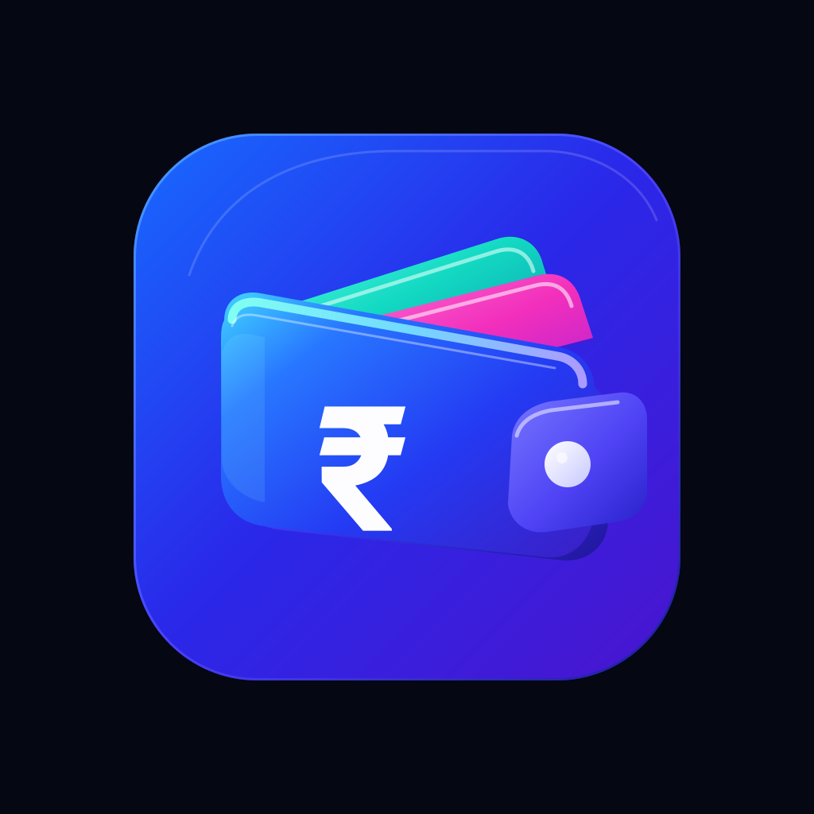

  <button id="themeToggleBtn" class="theme-toggle-btn" onclick="toggleCashBuddyTheme()"> Light Mode</button>

  

<h1 align="center" style="font-weight: 700; letter-spacing: -0.03em; margin-bottom: 4px;">CashBuddy</h1>

  Your Finances, 100% On-Device.

  A 100% offline, privacy-first personal finance and expense tracker built with Kotlin Multiplatform. Combining passive notification parsing, probabilistic Naive Bayes token learning, offline UPI screenshot OCR, global &amp; per-category budgets, and SQLCipher AES-256 hardware-backed encryption—with zero internet and zero SMS permissions.

  <a href="https://github.com/l1khith/CashBuddy/releases" class="cta-btn-primary">Download Release APK</a>
  <a href="https://github.com/l1khith/CashBuddy" class="cta-btn-secondary">GitHub</a>

  <a href="#-the-philosophy">Philosophy</a> &nbsp;•&nbsp;
  <a href="#-core-capabilities">Capabilities</a> &nbsp;•&nbsp;
  <a href="#%EF%B8%8F-technical-specifications">Architecture</a> &nbsp;•&nbsp;
  <a href="#2-privacy-policy">Privacy Policy</a> &nbsp;•&nbsp;
  <a href="#3-terms-of-service">Terms of Service</a> &nbsp;•&nbsp;
  <a href="#4-contact-information">Contact</a>

---

##  The Philosophy

Most personal finance apps demand invasive SMS permissions, upload your raw banking alerts to cloud servers, and monetize your spending habits. Even "private" expense trackers often bundle third-party analytics and telemetry SDKs that quietly transmit metadata in the background.

**CashBuddy** enforces financial sovereignty at the operating-system level:

| Dimension | Typical Expense Trackers | CashBuddy Offline Model |
|---|---|---|
| **Network Permission (`INTERNET`)** | Required (Cloud sync & analytics) | **Explicitly stripped (`0 bytes` leaves device)** |
| **SMS Permission (`READ_SMS`)** | Often requested (Reads all personal texts) | **Never requested (`NotificationListenerService` only)** |
| **Classification Engine** | Hardcoded cloud rules or remote LLMs | **On-device probabilistic Naive Bayes + learned tokens** |
| **Database Security** | Plaintext SQLite or remote cloud DB | **SQLCipher AES-256 + Android Hardware Keystore** |
| **Ambiguous / High-Value Alerts** | Silently auto-logged with errors | **Human-in-the-Loop Review Inbox (<85% or ≥₹10,000)** |
| **Cloud Auto-Backup** | Enabled by default | **Disabled (`allowBackup="false"`)** |

> *"Privacy is strongest when it is a technical guarantee rather than a policy promise. Without the internet permission, your financial ledger physically cannot leave your phone."*

Every parser, probability calculator, duplicate reconciler, and budget engine runs 100% locally on your device.

---

##  Core Capabilities

### 1. Passive Notification Listener Engine
Automatically captures UPI and banking transaction alerts in real time using Android's `BIND_NOTIFICATION_LISTENER_SERVICE`—without ever requesting `READ_SMS` or `RECEIVE_SMS` permissions.

### 2. Probabilistic Naive Bayes & Adaptive Token Learning
Replaces brittle keyword allowlists with structural shape detection and Laplace-smoothed log-likelihood ratios. As you confirm or discard items in your Review Inbox, CashBuddy learns your personal transaction vocabulary directly on-device.

### 3. Human-in-the-Loop Review Inbox
Never pollute your ledger with false positives. Any notification with classification confidence below `0.85` or an amount of `₹10,000` or more is automatically queued as `PENDING` for one-tap confirmation or correction.

### 4. Offline UPI Screenshot OCR
Missed a notification? Share any UPI payment screenshot (Google Pay, PhonePe, Paytm, BHIM) directly to CashBuddy via the Android Share Sheet. On-device OCR extracts the amount, merchant, and transaction type and deletes the cached screenshot immediately after parsing.

### 5. Global & Per-Category Budgets
Track monthly or weekly spending limits across individual categories alongside an overarching **Global Budget** that automatically computes unbudgeted spend and triggers local threshold alerts at 80% and 100%.

### 6. Automatic Duplicate Reconciliation
When a single payment generates both a UPI app notification and a bank SMS notification (or a shared screenshot), CashBuddy's deduplication engine reconciles them within a temporal window while preserving a full reversible merge audit log.

### 7. Instant Scoped-Storage CSV Export
Your financial data is never locked in. Export your complete transaction ledger at any time to standard RFC-4180 CSV files using Android's Storage Access Framework (SAF) with zero legacy storage permissions.

### 8. SQLCipher AES-256 & Biometric Hardware Lock
All local tables are encrypted at rest with 256-bit AES SQLCipher keys bound to the Android Hardware Keystore. Enable `BIOMETRIC_STRONG` fingerprint or face authentication on app launch with an automatic 5-minute background lock timeout.

---

## ️ Technical Specifications

CashBuddy is engineered with a pure Kotlin Multiplatform (KMP) architecture:

- **Language & Core:** 100% Pure Kotlin Multiplatform (`commonMain`, `androidMain`, `iosMain`) with Coroutines & `StateFlow`
- **UI Framework:** Compose Multiplatform with Material 3 design tokens
- **Encrypted Persistence:** SQLDelight 2.0.2 + SQLCipher for Android 4.6.1 (256-bit AES encryption)
- **Dependency Injection:** Koin 4.0 multiplatform DI
- **On-Device OCR:** Google ML Kit Text Recognition (with all transitive network/telemetry services stripped via Manifest merger rules)
- **Hardware Security:** AndroidX Biometric (`BIOMETRIC_STRONG`), Android Keystore (`MasterKey`), and `FLAG_SECURE` window protection in release builds

---

# Legal Policies & Terms of Service

## 1. Introduction

Welcome to CashBuddy ("we", "our", "us"). This document combines our Privacy Policy and Terms of Service. By downloading, installing, or using CashBuddy ("the App"), you agree to both the Privacy Policy and the Terms of Service described below. If you do not agree, please do not use the App.

---

## 2. Privacy Policy

### 2.1 Information Processed Locally on Your Device

CashBuddy operates under a strict **100% Offline, Zero-Server Architecture**. All data is processed and stored exclusively on your device:

**Local Data (Stored Only in Your Device's Encrypted Database):**
- Transaction records (amount, merchant name, category, timestamp, transaction type, notes)
- Global and per-category budget configurations
- Custom categories, learned merchant categorization rules, and on-device token frequency counts
- App preferences and biometric lock settings

**Notification & Screenshot Processing (In-Memory / Ephemeral):**
- **Incoming Notifications (`BIND_NOTIFICATION_LISTENER_SERVICE`):** When you grant Notification Access, CashBuddy inspects incoming notifications in volatile device memory (RAM) solely to detect financial transaction alerts. Non-financial notifications (personal messages, OTPs, promotional offers) are discarded immediately in memory.
- **Shared Screenshots (`ACTION_SEND`):** When you manually share a payment screenshot to CashBuddy, the image is copied temporarily to the App's private cache, parsed on-device via OCR, and deleted immediately after processing.

**Data We Do NOT Collect or Transmit:**
- No personal identifiable information (name, email, phone number) is ever collected
- No bank account credentials, UPI PINs, or full card numbers are ever requested or stored
- No location data, contact lists, camera, or microphone access
- **Zero external transmission:** CashBuddy explicitly removes `android.permission.INTERNET` and `android.permission.ACCESS_NETWORK_STATE` from its Android Manifest. Not a single byte of data can leave your device.

### 2.2 Permissions & Prominent Disclosure

The App requests the following permissions solely for local, on-device functionality:

| Permission | Purpose |
|------------|---------|
| **`BIND_NOTIFICATION_LISTENER_SERVICE`** | **Prominent Disclosure:** Used exclusively to read incoming banking and UPI payment notifications on-device so expenses can be logged automatically without manual entry. Notification content never leaves your device. |
| **`USE_BIOMETRIC`** | Used for optional hardware-backed fingerprint / face unlock (`BIOMETRIC_STRONG`) on app launch and after 5 minutes in the background. |
| **`POST_NOTIFICATIONS`** | Used to display local alerts when a transaction requires review in your Review Inbox or when a budget threshold is reached. |
| **`VIBRATE`** | Used for subtle haptic feedback on local interactions. |

All permissions are optional. You can revoke Notification Access or Biometric Lock at any time in Android Settings.

### 2.3 Zero Advertising & Zero Third-Party Analytics

CashBuddy contains:
- **Zero advertising SDKs** (100% ad-free)
- **Zero cloud analytics or telemetry SDKs**
- **Zero remote crash-reporting trackers**

Transitive background transport services bundled by on-device OCR libraries are explicitly removed at build time using `tools:node="remove"` in `AndroidManifest.xml`.

### 2.4 Data Storage & Cryptographic Security

- **SQLCipher AES-256 Encryption:** All local database tables are encrypted at rest using 256-bit AES encryption via SQLCipher.
- **Android Hardware Keystore:** The database encryption key is protected by the device's hardware-backed Android Keystore.
- **No Automatic Cloud Backups:** CashBuddy sets `android:allowBackup="false"` so your financial database is never uploaded to unencrypted cloud backups.
- **Screen Capture Protection:** Production release builds enforce `FLAG_SECURE` to protect sensitive financial screens from unauthorized capture and recent-apps task switcher previews.

### 2.5 Data Retention, Export & Deletion

- **User-Initiated Export:** You can export your transactions anytime to a local CSV file via Android's Storage Access Framework (SAF).
- **Instant Complete Deletion:** You can permanently erase all transactions, learned rules, and training data at any time via **Settings → Delete All Transactions** and **Settings → Reset Training Data**, or by uninstalling the App.

### 2.6 Children's Privacy

CashBuddy is not directed at children under 13 and does not collect any data from any user.

### 2.7 Changes to This Privacy Policy

We may update this Privacy Policy from time to time. Our constitutional commitment to 100% offline, zero-network processing will never change. Continued use of the App constitutes acceptance of the updated policy.

---

## 3. Terms of Service

### 3.1 Acceptance of Terms

By downloading, installing, or using CashBuddy, you agree to these Terms of Service. If you disagree with any part of these terms, do not use the App.

### 3.2 User Accounts & Local Data Custody

CashBuddy does not use user accounts or cloud servers. All data resides exclusively on your device. Accordingly, you are solely responsible for:
- Exporting and backing up your transaction history (via CSV export)
- Maintaining the physical and biometric security of your device
- Any data loss resulting from device loss, factory reset, app data clearing, or uninstallation (since we possess no server copy of your data, we cannot recover lost local databases)

### 3.3 Non-Financial Advice & Automated Parsing Accuracy

- **Informational Bookkeeping Utility Only:** CashBuddy is a personal expense-tracking tool, not a bank, payment processor, accounting firm, or licensed financial advisor. Nothing in the App constitutes financial, tax, or legal advice.
- **Human-in-the-Loop Verification:** While CashBuddy uses a calibrated probabilistic classifier and flags low-confidence alerts (`< 0.85`) and high-value transactions (`≥ ₹10,000`) for manual review, automated text and OCR extraction is subject to formatting changes by banks and UPI apps. You are responsible for reviewing pending transactions and verifying your records against official bank statements.

### 3.4 User Conduct

You agree NOT to:
- Use the App for any unlawful or fraudulent purpose
- Attempt to bypass local security controls or redistribute modified versions of the App misrepresented as official releases

### 3.5 Intellectual Property & Open-Source Attributions

CashBuddy, including its source code, architecture, and brand assets, is owned by the developer and protected by applicable copyright laws.
- **Typography Attribution:** CashBuddy includes the *Roboto* font family, licensed under the [Apache License, Version 2.0](https://www.apache.org/licenses/LICENSE-2.0).
- **Open-Source Software:** Built with Kotlin Multiplatform, Compose Multiplatform, SQLDelight, Koin, and SQLCipher for Android under their respective open-source licenses.

### 3.6 Disclaimer of Warranties

CashBuddy is provided **"as is"** and **"as available"** without warranties of any kind, either express or implied, including but not limited to implied warranties of merchantability, fitness for a particular purpose, accuracy of automated notification/OCR parsing, or uninterrupted operation.

### 3.7 Limitation of Liability

To the maximum extent permitted by applicable law, the developer shall NOT be liable for:
- Any loss of data (due to uninstallation, device failure, or clearing app storage)
- Any parsing inaccuracies, missed notifications, or budget calculation discrepancies
- Any indirect, incidental, special, or consequential damages arising out of your use or inability to use the App

### 3.8 Indemnification

You agree to indemnify and hold harmless the developer from any claims, damages, or expenses arising from your use of the App or violation of these Terms.

### 3.9 Changes to These Terms

We reserve the right to update these Terms at any time. Changes become effective immediately upon posting on this page.

### 3.10 Governing Law

These Terms are governed by the laws of India, without regard to conflict of laws principles.

### 3.11 Severability

If any provision of these Terms is found to be unenforceable, the remaining provisions shall remain in full force and effect.

### 3.12 Entire Agreement

This document constitutes the entire agreement between you and the developer regarding the use of CashBuddy.

---

## 4. Contact Information

**Developer:** Likhith  
**Email:** likid2d21@gmail.com  
**GitHub:** [https://github.com/l1khith](https://github.com/l1khith)  
**App Website:** [https://l1khith.github.io/CashBuddy](https://l1khith.github.io/CashBuddy)

For privacy questions, support, or inquiries regarding these terms, please contact the email above or open an issue on GitHub.

---

**Last Updated:** October 10, 2026
